```{=html}
<div class="viewtoggle" role="tablist" aria-label="View">
<button class="vt-btn" data-view="list" aria-pressed="true">List</button>
<button class="vt-btn" data-view="covers" aria-pressed="false">Covers</button>
</div>
<div class="coverwall">
<a class="ccard" href="https://www.journalofdemocracy.org/online-exclusive/why-democracy-by-referendum-seldom-works/">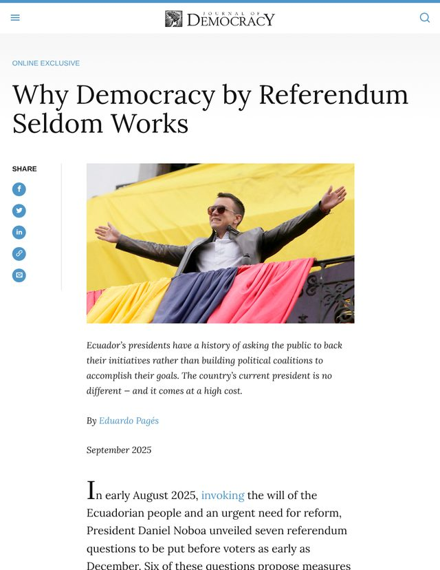<span class="cinfo"><span class="ckind">Essay · 2025</span><span class="ctitle">Why Democracy by Referendum Seldom Works</span><span class="cauth">Pagés, Eduardo</span><span class="cgo">Open ↗</span></span></a>
<a class="ccard" href="https://keough.nd.edu/news-and-events/news/is-there-a-playbook-for-defending-democracy/">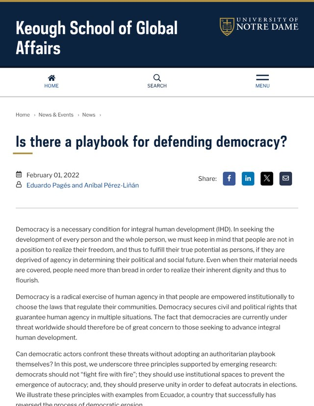<span class="cinfo"><span class="ckind">Blog post · 2022</span><span class="ctitle">Is There a Playbook for Defending Democracy?</span><span class="cauth">Pagés, Eduardo, and Aníbal Pérez-Liñán</span><span class="cgo">Open ↗</span></span></a>
<a class="ccard" href="https://doi.org/10.33774/apsa-2025-qh8h4-v2">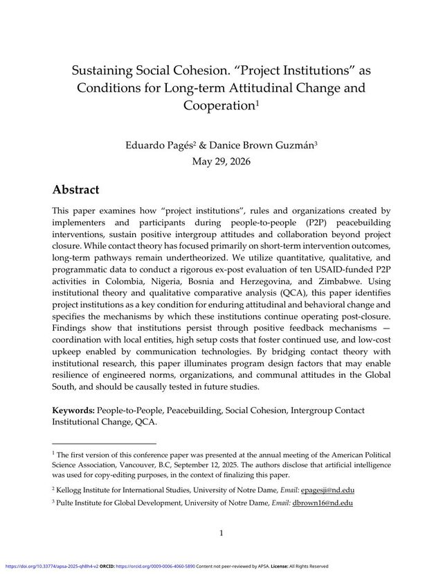<span class="cinfo"><span class="ckind">Working paper · 2026</span><span class="ctitle">Sustaining Social Cohesion: &#x27;Project Institutions&#x27; as Conditions for Long-Term Peacebuilding</span><span class="cauth">Pagés, Eduardo, and Danice Brown Guzmán</span><span class="cgo">Open ↗</span></span></a>
<a class="ccard" href="https://doi.org/10.7274/29825291.v1">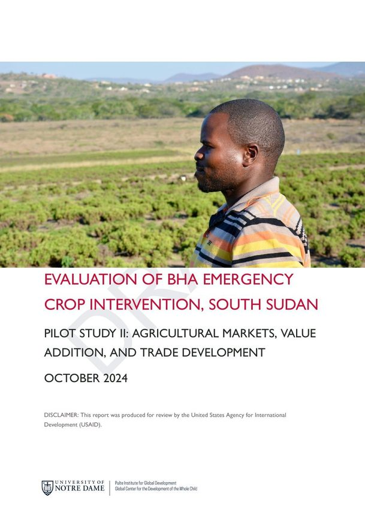<span class="cinfo"><span class="ckind">Evaluation report · 2025</span><span class="ctitle">ERIE Evaluation of BHA Emergency Crop Intervention, South Sudan. Pilot Study 2: Agricultural Markets, Value Addition, and Trade Development</span><span class="cauth">Bolten, Catherine, Shriniwas Gautam, Danice Brown Guzmán, Eksander Ataallah, Lila Khatiwada, and Eduardo Pagés</span><span class="cgo">Open ↗</span></span></a>
<a class="ccard" href="https://doi.org/10.7274/29402405.v1">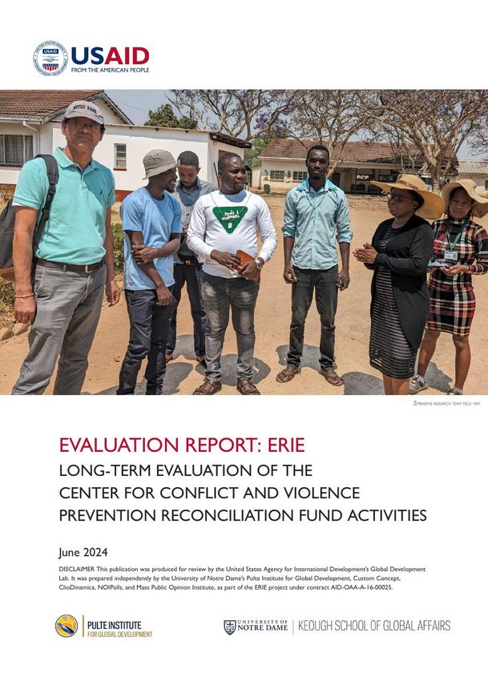<span class="cinfo"><span class="ckind">Evaluation report · 2025</span><span class="ctitle">Long-term Evaluation of the Center for Conflict and Violence Prevention (CVP) Reconciliation Fund Activities</span><span class="cauth">Brown Guzmán, Danice, Lila Khatiwada, Jaclyn Biedronski, Eduardo Pagés, and Paul Friesen</span><span class="cgo">Open ↗</span></span></a>
<a class="ccard" href="https://doi.org/10.7274/33145610.v1">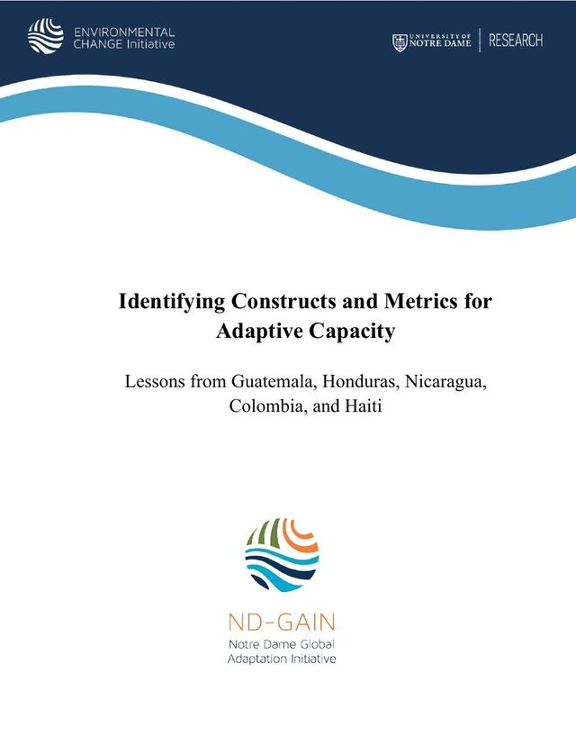<span class="cinfo"><span class="ckind">Evaluation report · 2023</span><span class="ctitle">Identifying Constructs and Metrics for Adaptive Capacity: Lessons from Guatemala, Honduras, Nicaragua, Colombia, and Haiti</span><span class="cauth">Wood, Danielle, Thomas Mustillo, Eduardo Pagés, Mikaela Bona, Brian Wanbaugh, and Mohammad Farrae</span><span class="cgo">Open ↗</span></span></a>
<a class="ccard" href="https://doi.org/10.7274/33179318.v1">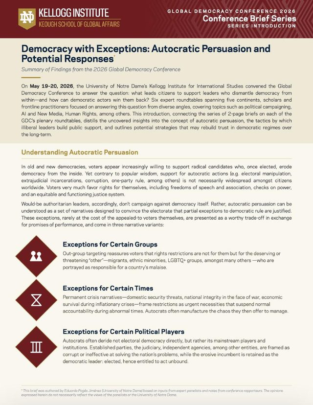<span class="cinfo"><span class="ckind">Policy brief · 2026</span><span class="ctitle">Democracy with Exceptions: Autocratic Persuasion and Potential Responses</span><span class="cauth">Pagés, Eduardo</span><span class="cgo">Open ↗</span></span></a>
<a class="ccard" href="https://curate.nd.edu/articles/report/_b_Policy_brief_b_From_Crisis_to_Continuity_Strengthening_Agricultural_Resilience_through_Evidence/31985403">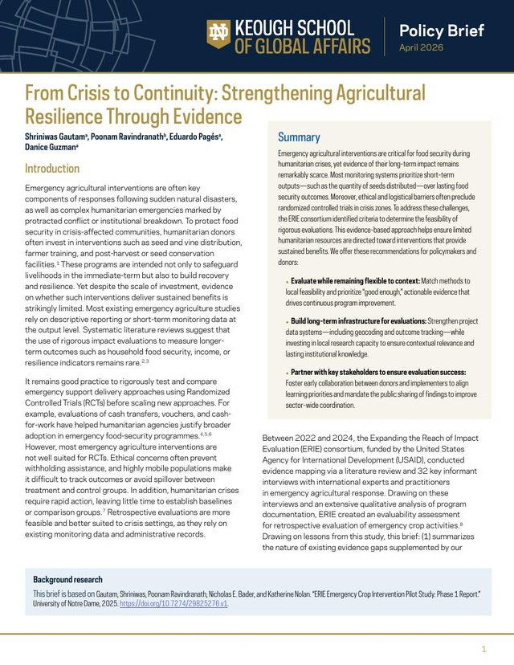<span class="cinfo"><span class="ckind">Policy brief · 2026</span><span class="ctitle">From Crisis to Continuity: Strengthening Agricultural Resilience through Evidence</span><span class="cauth">Gautam, Shriniwas, P. Ravindranath, Eduardo Pagés, and Danice Brown Guzmán</span><span class="cgo">Open ↗</span></span></a>
<a class="ccard" href="https://www.iri.org/wp-content/uploads/2024/04/Evidence-Briefer-Political-Parties-and-Opposition-to-Democratic-Erosion.pdf">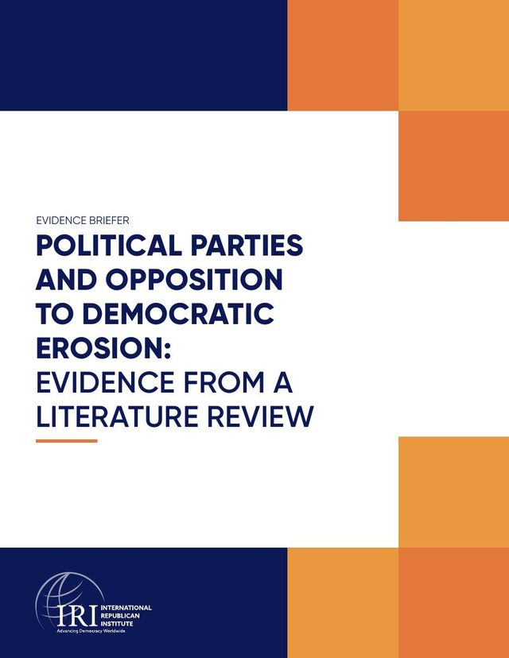<span class="cinfo"><span class="ckind">Policy brief · 2024</span><span class="ctitle">Evidence Briefer: Political Parties and Opposition to Democratic Erosion</span><span class="cauth">International Republican Institute</span><span class="cgo">Open ↗</span></span></a>
<a class="ccard" href="https://www.norc.org/PDFs/Democratic%20Backsliding%20Panel/Democratic%20Backsliding%20Panel%20-%20Brief%20-%20English.pdf">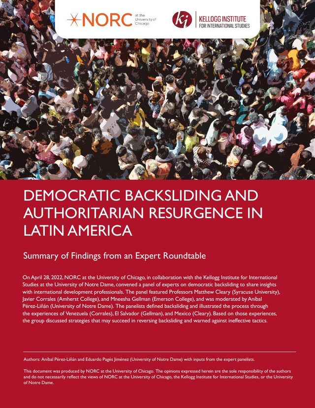<span class="cinfo"><span class="ckind">Policy brief · 2023</span><span class="ctitle">Democratic Backsliding and Authoritarian Resurgence in Latin America</span><span class="cauth">Pérez-Liñán, Aníbal, and Eduardo Pagés</span><span class="cgo">Open ↗</span></span></a>
<a class="ccard" href="https://doi.org/10.7274/p8418k75509">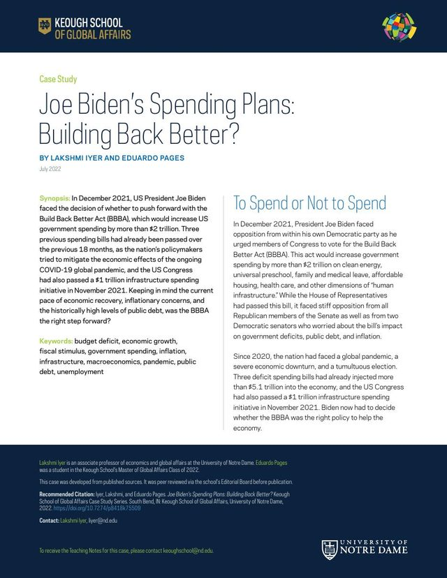<span class="cinfo"><span class="ckind">Teaching case studie · 2022</span><span class="ctitle">Joe Biden&#x27;s Spending Plans: Building Back Better?</span><span class="cauth">Pagés, Eduardo, and Lakshmi Iyer</span><span class="cgo">Open ↗</span></span></a>
</div>
```

::: {.listview}


## Articles and essays

::: {.pub}
**Pagés, Eduardo.** 2025. "Why Democracy by Referendum Seldom Works." *Journal of Democracy*, Online Exclusive, September 10.<br>
[Link](https://www.journalofdemocracy.org/online-exclusive/why-democracy-by-referendum-seldom-works/){.tag}
:::

::: {.pub}
**Pagés, Eduardo,** and Aníbal Pérez-Liñán. 2022. "Is There a Playbook for Defending Democracy?" *Dignity and Development* (blog), Keough School of Global Affairs, University of Notre Dame, February 1. Reposted by the Kellogg Institute for International Studies.<br>
[Link](https://keough.nd.edu/news-and-events/news/is-there-a-playbook-for-defending-democracy/){.tag} [Kellogg](https://kellogg.nd.edu/news/there-playbook-defending-democracy){.tag}
:::

## Working papers

::: {.pub}
**Pagés, Eduardo,** and Danice Brown Guzmán. 2026. "Sustaining Social Cohesion: 'Project Institutions' as Conditions for Long-Term Peacebuilding." *APSA Preprints*. Presented at the 2025 Annual Meeting of the American Political Science Association.<br>
[Preprint](https://doi.org/10.33774/apsa-2025-qh8h4-v2){.tag}
:::

::: {.pub}
Brown Guzmán, Danice, Lila Khatiwada, Jaclyn Biedronski, **Eduardo Pagés,** and Paul Friesen. 2027. "Won't You Be My Neighbor? Willingness to Interact and Friendship between Identity Groups in Nigeria and Zimbabwe." Working paper.
:::

::: {.pub}
Mustillo, Thomas, **Eduardo Pagés,** and Jeffrey J. Harden. 2026. "Inferring Global Networks of Democratic Policy Diffusion." Working paper. University of Notre Dame. Presented at the 2026 Annual Meeting of the Midwest Political Science Association.
:::

## Evaluation reports

::: {.pub}
Bolten, Catherine, Shriniwas Gautam, Danice Brown Guzmán, Eksander Ataallah, Lila Khatiwada, and **Eduardo Pagés.** 2025. *ERIE Evaluation of BHA Emergency Crop Intervention, South Sudan. Pilot Study 2: Agricultural Markets, Value Addition, and Trade Development.* University of Notre Dame and USAID.<br>
[DOI](https://doi.org/10.7274/29825291.v1){.tag}
:::

::: {.pub}
Brown Guzmán, Danice, Lila Khatiwada, Jaclyn Biedronski, **Eduardo Pagés,** and Paul Friesen. 2025. *Long-term Evaluation of the Center for Conflict and Violence Prevention (CVP) Reconciliation Fund Activities.* University of Notre Dame and USAID.<br>
[DOI](https://doi.org/10.7274/29402405.v1){.tag}
:::

::: {.pub}
Wood, Danielle, Thomas Mustillo, **Eduardo Pagés,** Mikaela Bona, Brian Wanbaugh, and Mohammad Farrae. 2023. *Identifying Constructs and Metrics for Adaptive Capacity: Lessons from Guatemala, Honduras, Nicaragua, Colombia, and Haiti.* ND-GAIN Technical Report. University of Notre Dame.<br>
[DOI](https://doi.org/10.7274/33145610.v1){.tag}
:::

## Policy briefs

::: {.pub}
**Pagés, Eduardo.** 2026. "Democracy with Exceptions: Autocratic Persuasion and Potential Responses." Global Democracy Conference report. Kellogg Institute for International Studies, University of Notre Dame.<br>
[DOI](https://doi.org/10.7274/33179318.v1){.tag}
:::

::: {.pub}
Gautam, Shriniwas, P. Ravindranath, **Eduardo Pagés,** and Danice Brown Guzmán. 2026. "From Crisis to Continuity: Strengthening Agricultural Resilience through Evidence." Policy brief. University of Notre Dame.<br>
[Link](https://curate.nd.edu/articles/report/_b_Policy_brief_b_From_Crisis_to_Continuity_Strengthening_Agricultural_Resilience_through_Evidence/31985403){.tag}
:::

::: {.pub}
International Republican Institute. 2024. *Evidence Briefer: Political Parties and Opposition to Democratic Erosion.* Contributor.<br>
[PDF](https://www.iri.org/wp-content/uploads/2024/04/Evidence-Briefer-Political-Parties-and-Opposition-to-Democratic-Erosion.pdf){.tag}
:::

::: {.pub}
Pérez-Liñán, Aníbal, and **Eduardo Pagés.** 2023. *Democratic Backsliding and Authoritarian Resurgence in Latin America.* NORC at the University of Chicago and Kellogg Institute for International Studies.<br>
[PDF](https://www.norc.org/PDFs/Democratic%20Backsliding%20Panel/Democratic%20Backsliding%20Panel%20-%20Brief%20-%20English.pdf){.tag}
:::

## Teaching case studies

::: {.pub}
**Pagés, Eduardo,** and Lakshmi Iyer. 2022. "Joe Biden's Spending Plans: Building Back Better?" Case study. University of Notre Dame.<br>
[DOI](https://doi.org/10.7274/p8418k75509){.tag}
:::

## Data

::: {.pub}
Pedroza, Luicy, Pau Palop García, et al. 2022. *IMISEM Dataset: Every Immigrant Is an Emigrant.* Contributor (data collection for Uruguay and the Dominican Republic).<br>
[DOI](https://doi.org/10.7802/2380){.tag}
:::

:::

```{=html}
<script>
(function(){
  var root=document.body;
  function set(v){root.classList.toggle('view-covers',v==='covers');
    document.querySelectorAll('.vt-btn').forEach(function(b){b.setAttribute('aria-pressed',b.dataset.view===v)});
  }
  document.querySelectorAll('.vt-btn').forEach(function(b){b.addEventListener('click',function(){set(b.dataset.view)})});
  set('list');
})();
</script>
```
